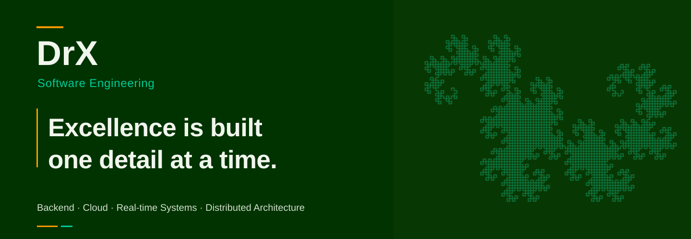

<picture>
  <source media="(max-width: 640px)" srcset="./assets/dragon-curve-mobile.svg">
  
</picture>

 

## 01 / About

I build software across **backend services, desktop applications, and cloud infrastructure**, with an interest in real-time communication and distributed systems. My approach is grounded in clear architecture, practical problem-solving, and attention to implementation details.

My background combines **Engineering Physics, applied mathematics, and computer science** with hands-on software development.

## 02 / Selected work

### Fortza Couriers

**Full-Stack Logistics Operations Prototype** · [Live demo ↗](https://fortzacouriers.drx-svg.workers.dev/)

A bilingual logistics platform featuring **courier and dispatcher dashboards**, recruitment workflows, fleet management, delivery tracking, and interactive maps. Built a custom **Nearest Neighbor + 2-opt route optimization system**, integrated OSRM road routing and Leaflet/OpenStreetMap visualization. Deployed on Cloudflare Workers, with browser-based demo persistence and simulated operational data.

       

### [ParcelDesk](https://github.com/DrX-svg/ParcelDesk)

A full-stack Windows parcel-management application with a **WinForms client**, **ASP.NET Core REST API**, and **Entity Framework Core** persistence. Features shipment workflows, AWB generation, tracking history, standalone SQLite or MySQL deployment, and a self-contained Windows installer.

      

### [ArenaPULSE](https://github.com/DrX-svg/ArenaPULSE)

**Backend / Web** · [Live demo ↗](https://arena-pulse.pages.dev)

A responsive Counter-Strike 2 match dashboard integrating the **GRID Open Access GraphQL API**. Features secure server-side authentication, data normalization through **Node.js / Express**, REST endpoints, filtering, and a responsive frontend deployed on Cloudflare Pages.

     

### [Romanian Voice Typing Overlay](https://github.com/DrX-svg/romanian-voice-typing-overlay-python)

An open-source Windows application for **fully local Romanian speech-to-text** using faster-whisper and CTranslate2. Features configurable ASR presets, microphone selection, global hotkeys, automatic text insertion, persistent settings, and PowerShell-based setup tooling.

     

### [Project Zomboid — OCI ARM64 Server](https://github.com/DrX-svg/ProjectZomboid-OCI-Server-ARM64)

A cloud infrastructure project running an **x86-64 multiplayer server on Oracle Cloud ARM64** using Docker and FEX-Emu. Includes Python RCON automation, Discord integration, systemd watchdog recovery, JVM troubleshooting, and performance profiling for world-streaming workloads.

       

### 3D Physics Multiplayer Prototype

**Game Systems / Networking** · *In Development*

A physics-driven 3D multiplayer project built in **Godot 4**, featuring animated character movement, combat, ragdolls, interactive physics objects, and synchronized vehicles. Developed **server-authoritative networking**, dynamic authority handoffs, offline/LAN/online sessions using ENet and NodeTunnel, and chunk-based world streaming. Also includes custom debugging tools and a **procedural Building Replacer editor plugin** supporting configurable architecture and irregular building footprints.

        

## 03 / Engineering toolkit

**Languages**

           

**Frontend & Web**

         

**Backend & APIs**

      

**Data**

   

**Software Engineering**

         

**Cloud & systems**

             

**Desktop, AI & Game Development**

         

**Embedded & Engineering**

         

**Development Tools & Platforms**

      

## 04 / Current focus

Building reliable backend and cloud-based systems, while exploring **server-authoritative multiplayer architecture**, state replication, and real-time networking.

## 05 / Connect

[Explore my repositories ↗](https://github.com/DrX-svg?tab=repositories)

---

 · DrX · 
